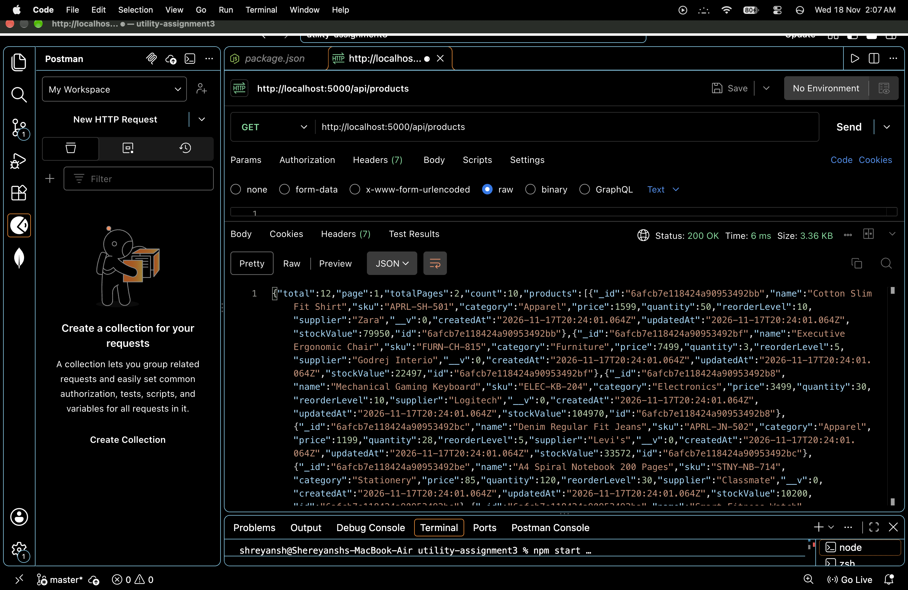
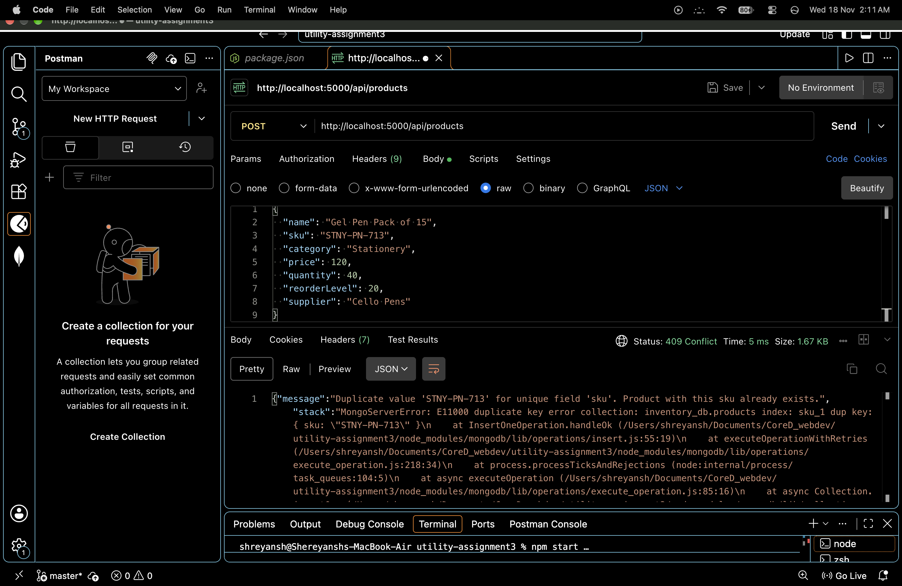
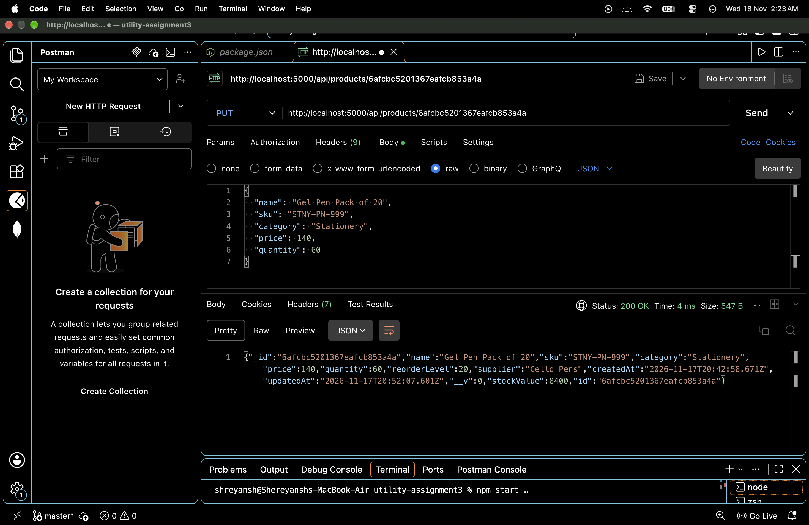
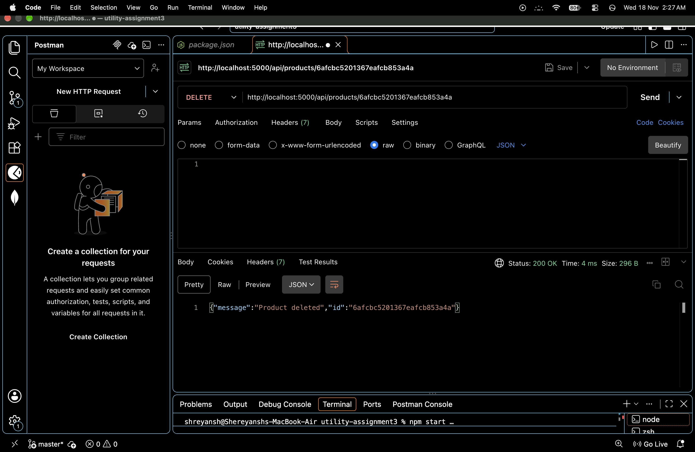
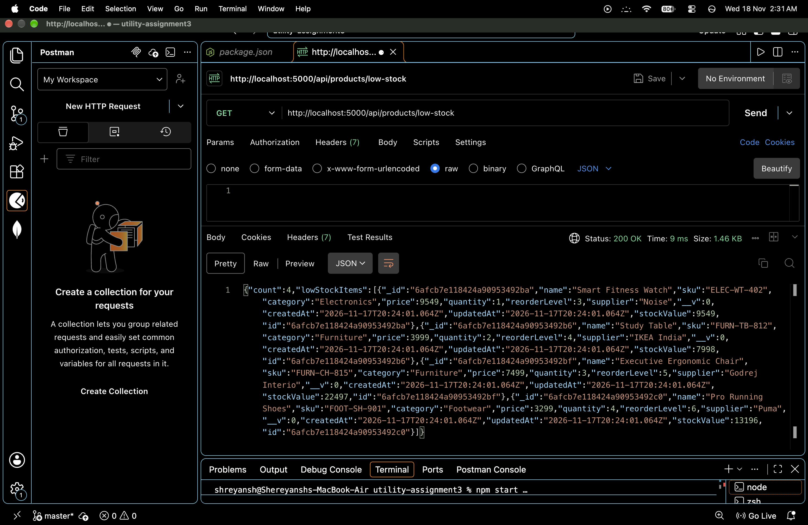
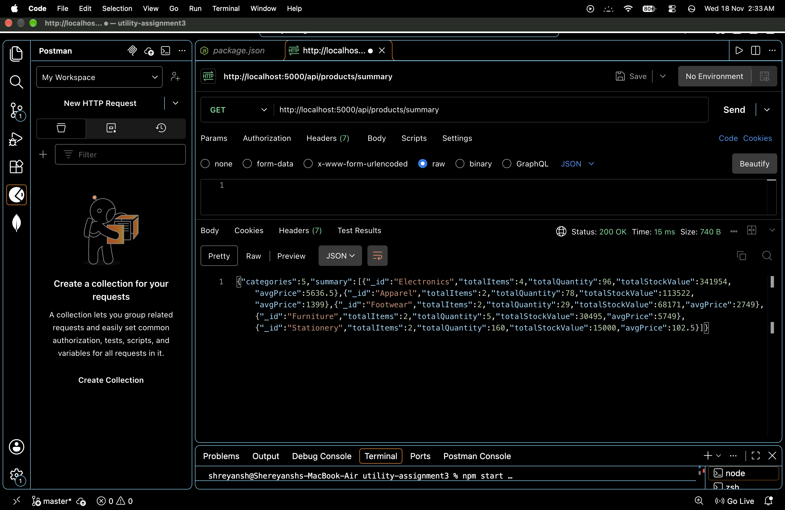
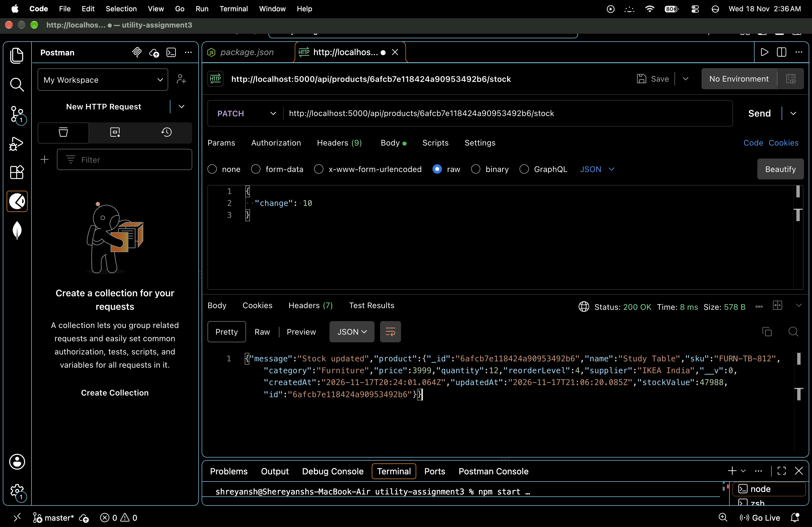

## API Testing Screenshots (Postman)

### 1. Get All Products

### 2. Create Product (POST)

### 3. Update Product (PUT)

### 4. Delete Product (DELETE)

### 5. Low-Stock Alert Report

### 6. Category-wise Summary (Aggregation)

### 7. Stock Adjustment (PATCH)

